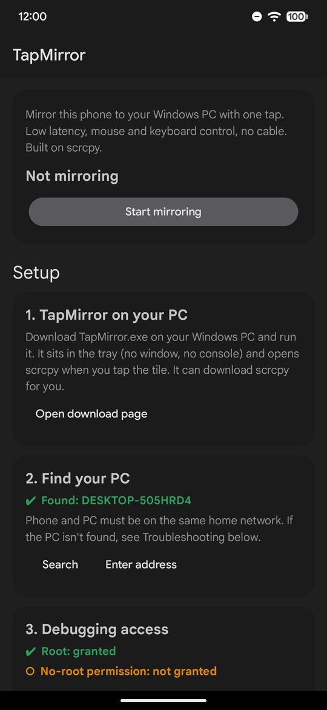
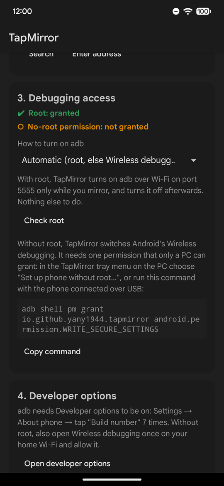
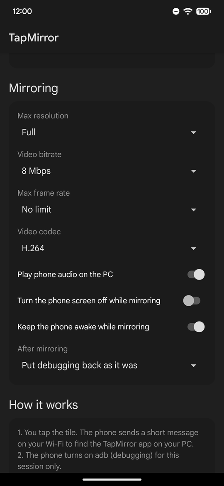

<p align="center">
  
</p>

<h1 align="center">TapMirror</h1>

<p align="center">
  Tap a tile in Android quick settings and your phone's screen opens on your Windows PC.<br>
  Over Wi-Fi, with mouse and keyboard control. Built on <a href="https://github.com/Genymobile/scrcpy">scrcpy</a>.
</p>

<p align="center">
  <a href="https://github.com/Yany1944/TapMirror/releases/latest"></a>
  <a href="https://github.com/Yany1944/TapMirror/actions/workflows/build.yml"></a>
  
  
  <a href="LICENSE"></a>
</p>

<p align="center"><b>English</b> · <a href="README.ru.md">Русский</a></p>

> [!NOTE]
> This is an early version (0.1.0). So far it has been tested on one phone and one PC, listed under [Tested on](#tested-on). Bugs are likely, especially on other phones. If something doesn't work, please [open an issue](https://github.com/Yany1944/TapMirror/issues/new/choose): the app can copy everything the report needs.

<p align="center">
  
  &nbsp;
  
  &nbsp;
  
</p>

## What it does

scrcpy already shows an Android screen on a PC with very little lag and lets you control it with the mouse and keyboard. To use it over Wi-Fi you normally connect a cable, run `adb tcpip`, type the phone's address into a console, and remember to turn debugging off afterwards. TapMirror does all of that for you:

- The "Mirror to PC" tile in quick settings starts mirroring. Tap it again to stop, or just close the window.
- A small tray app on the PC waits for the phone and opens scrcpy without a console window. While it waits it uses no CPU and about 25 MB of memory.
- Debugging is on only while you mirror. The phone turns adb on when you tap the tile and puts it back as it was when the session ends. Banking and government apps that refuse to run while USB debugging is on keep working the rest of the time.
- It works with root and without. Root was tested with Magisk; KernelSU and APatch provide the same `su`, so they should work too. Without root you grant one permission from the PC once.
- The phone app is also the setup guide: a checklist with a button for each step, plus resolution, bitrate, frame rate, codec, audio and other scrcpy settings.
- The first time a phone asks to mirror, the PC shows a window to allow or block it.
- English and Russian.

## How it works

```
 Phone                                               PC (tray app)
 ─────                                               ─────────────
 You tap the tile
 "Is there a TapMirror PC?"  ── UDP 27199 ──────▶    "Yes, I'm DESKTOP-ABC"
 Turns adb on for this session:
   root:    adb over TCP, port 5555
   no root: Wireless debugging
 "Please start mirroring"    ─────────────────▶     First time: "Allow this phone?"
                                                     adb connect, then scrcpy
                             ◀─────────────────     "The window is open"
 "Still there?" every 3 s    ─────────────────▶     "Yes"
                             ◀─────────────────     "The window was closed"
 Turns adb back off
```

If the window closes, you tap the tile again, the PC goes to sleep or the phone leaves Wi-Fi, the phone turns debugging off within about 12 seconds. The message format is in [docs/protocol.md](docs/protocol.md).

## Requirements

- An Android phone with Android 11 or newer.
- A Windows 10 or 11 PC (64-bit). It uses the .NET Framework 4.8 that comes with Windows, so there is nothing else to install.
- Both on the same home network, able to see each other. Guest networks and routers with "AP isolation" or "client isolation" turned on block this.
- Either root, or a PC with adb once to grant the no-root permission (the tray app can do it for you over USB or with a pairing code).

## Easy setup with an AI assistant

If you use an AI assistant on your PC, it can do the setup with you: check that your phone and PC are suitable, install both apps and tell you what to turn on for your phone, rooted or not. Copy this message into it:

```text
Help me set up TapMirror (Android screen mirroring to Windows). Read https://raw.githubusercontent.com/Yany1944/TapMirror/main/docs/ai-setup.md and follow it step by step. Explain what you do and ask me before installing or changing anything.
```

Assistants that can run commands on your PC (Claude Code, Codex CLI, Cursor, Gemini CLI) do the checks themselves. A chat in the browser (ChatGPT, Claude, Gemini) gives you commands to run in PowerShell and reads what you paste back. Keep the phone and a USB cable nearby.

The assistant follows [docs/ai-setup.md](docs/ai-setup.md); you can read it first. It lists everything it checks and changes and how to undo it, and it only downloads from GitHub (TapMirror, scrcpy) and Google (adb). Still, read each command before you allow it.

If you prefer to do it yourself, the steps are below.

## Install

### 1. On the PC

1. Download [TapMirror.exe](https://github.com/Yany1944/TapMirror/releases/latest/download/TapMirror.exe), put it in a folder of its own (for example `Documents\TapMirror`) and run it.
2. Windows may show "Windows protected your PC" because the file isn't signed. Click "More info", then "Run anyway".
3. On the first run TapMirror offers to:
   - download the latest official scrcpy from GitHub (it checks the SHA-256 checksum);
   - add a Windows Firewall rule for UDP port 27199 (asks for administrator rights).

   Say yes to both. TapMirror now lives in the tray and starts with Windows.

### 2. On the phone

1. Download [TapMirror.apk](https://github.com/Yany1944/TapMirror/releases/latest/download/TapMirror.apk) and install it. Android will ask to allow installs from your browser; Play Protect may offer to scan the app.
2. Open TapMirror. The first screen is a checklist; go through it from the top:
   1. TapMirror on the PC.
   2. Find your PC (the Search button).
   3. Debugging access. With root, tap "Check root" and allow it in your root manager. Without root, see below.
   4. Developer options. Turn them on if you haven't: Settings → About phone → tap "Build number" 7 times.
   5. Add the quick settings tile.
   6. Notifications on, or off if you want only the tile.
3. Tap the tile. The first time, the PC asks whether to allow this phone, and the phone may ask "Allow USB debugging?" for this PC. Tick "Always allow".

### Without root

Without root, the app switches Android's Wireless debugging on and off itself. For that it needs the `WRITE_SECURE_SETTINGS` permission, which only a computer can grant. In the PC tray menu choose "Set up a phone without root…" and use one of the two ways:

- With a cable: turn on USB debugging, connect the phone, tap "Allow" on the phone, click "Grant over USB".
- Without a cable: on the phone open Developer options → Wireless debugging → "Pair device with pairing code", type the address and code into the window, click "Pair and grant".

If you already use adb, this command does the same:

```
adb shell pm grant io.github.yany1944.tapmirror android.permission.WRITE_SECURE_SETTINGS
```

Then, on each Wi-Fi network you use, open Wireless debugging once and allow it ("Always allow on this network").

|  | Root | No root |
|---|---|---|
| How adb is turned on | `su`: adb over TCP on port 5555 | Wireless debugging, through `WRITE_SECURE_SETTINGS` |
| One-time setup | allow root for the app | grant the permission from a PC |
| On a new Wi-Fi network | nothing | allow Wireless debugging there once |
| How the PC finds adb | fixed port | mDNS |
| After mirroring | debugging is put back as it was | Wireless debugging is turned off |

## Settings

On the phone, under "Mirroring" in the app:

| Setting | Default | What it changes |
|---|---|---|
| Max resolution | Full | scrcpy `--max-size` |
| Video bitrate | 8 Mbps | scrcpy `--video-bit-rate` |
| Max frame rate | No limit | scrcpy `--max-fps` |
| Video codec | H.264 | scrcpy `--video-codec` |
| Play phone audio on the PC | On | scrcpy `--no-audio` when off |
| Turn the phone screen off while mirroring | Off | scrcpy `--turn-screen-off` |
| Keep the phone awake while mirroring | On | scrcpy `--stay-awake` |
| After mirroring | Put debugging back as it was | or always turn it off |

Notifications (step 6): with them on, a notification shows the status and a Stop button while mirroring. Android doesn't let an app hide that notification itself, so for "tile only" you turn TapMirror's notifications off in system settings; the step's button opens that page.

On the PC, `%APPDATA%\TapMirror\TapMirror.ini` holds the scrcpy folder, an optional path to adb, extra scrcpy options for every session (for example `args=--window-borderless`) and the allowed and blocked phones. The tray menu covers the usual cases. The log is in `%LOCALAPPDATA%\TapMirror\TapMirror.log` (tray menu → "Open log").

## Tested on

| | |
|---|---|
| Phone | Google Pixel 7 Pro, Android 17 QPR3 Beta 2 |
| Root | Magisk Alpha. No-root mode was tested on the same phone with root mode switched off in the app |
| PC | Windows 11 Pro 26H2 (build 26300), connected by Ethernet; the phone on 5 GHz Wi-Fi |
| scrcpy and adb | scrcpy 4.1, adb 37.0.1 |
| VPN | a VPN app on the phone that other apps can't bypass |

What worked: starting and stopping from the tile, closing the window, tapping fast several times in a row, approving a new phone on the PC, root and no-root modes, debugging being put back afterwards, the 12-second timeout, and mirroring with the VPN on.

Not tested yet: other phones and Android 11 to 16, KernelSU and APatch, Windows 10, a PC with Windows Firewall turned on, the scrcpy download, pairing with a code, several PCs or several phones at once. If you try any of these, a short "works" or "doesn't work" in an issue helps a lot.

## Known issues and limitations

- VPN on the phone. VPNs that apps can't bypass let the phone reach the PC only at an address it already knows, so the first search may find nothing. Search once with the VPN off, or tap "Enter address" in step 2 and type the address shown in the tray menu ("This PC: …"). After that it works with the VPN on.
- No root. Android doesn't let ordinary apps read the debugging settings, so without root TapMirror can't tell whether Wireless debugging was on before, and always turns it off after a session. For the same reason the app can't show whether Developer options are on.
- Tile only. With notifications off, errors appear only on the tile ("Failed, open app") and in the app.
- Windows only. There is no PC app for macOS or Linux yet, and the PC app itself is in English.
- AV1. Most phones have no AV1 encoder; if mirroring fails with AV1, use H.264 or H.265.
- Security. Messages between the phone and the PC aren't encrypted or signed, so use TapMirror on networks you trust, like your home Wi-Fi. While a session runs, adb on the phone is reachable from the network, though it still only accepts PCs you have allowed. Details are in [docs/protocol.md](docs/protocol.md#security-notes).

## Troubleshooting

| Problem | What to try |
|---|---|
| "No PC answered" | Check that TapMirror is in the tray on the PC and both devices are on the same network. If the tray menu has "Allow through Windows Firewall", click it. Guest networks and AP isolation block devices from seeing each other. |
| "No PC answered" with a VPN on | Tap "Enter address" in step 2 (see "VPN on the phone" above). |
| The window doesn't open, adb error | The phone may be asking "Allow USB debugging?" for this PC. Unlock it and tick "Always allow". |
| No root: "Wireless debugging didn't start on the phone" | Open Developer options → Wireless debugging once on this network and allow it. |
| A banking app complains about debugging | Set "After mirroring" to "Always turn debugging off". |
| Lag or low quality | Lower the resolution or bitrate, use 5 GHz Wi-Fi, connect the PC by cable if you can. |
| "Port 27199 is already in use" on the PC | Another copy of TapMirror is running. Close it from the tray, or end it in Task Manager. |

## Reporting a bug

Use the [bug report form](https://github.com/Yany1944/TapMirror/issues/new?template=bug_report.yml). Before filling it in, copy the diagnostic info:

- on the phone: TapMirror → Troubleshooting → "Copy info for a bug report";
- on the PC: tray menu → "Copy info for a bug report".

Paste both into the form. They contain the versions, your setup (mode, root, VPN, firewall) and the recent log, and nothing from other apps. Ideas go into a [feature request](https://github.com/Yany1944/TapMirror/issues/new?template=feature_request.yml). Please don't post security problems in public issues; [SECURITY.md](SECURITY.md) explains how to report them.

## Building from source

- PC app: run `windows\build.cmd`. It uses the C# compiler that ships with Windows, so no SDK is needed. The result is `windows\bin\TapMirror.exe`.
- Phone app: you need JDK 17 or newer and the Android SDK with platform 35. In `android`, run `gradlew assembleDebug`. For a signed release see [docs/RELEASING.md](docs/RELEASING.md).
- `build.cmd` in the root folder builds both into `dist\`.

```
android/   phone app (Java, no libraries): tile, session service, setup checklist, settings
windows/   tray app (C#, .NET Framework 4.8): UDP listener, scrcpy launcher, no-root setup window
docs/      protocol, setup guide for AI assistants, release steps, screenshots
```

Contributions are welcome; [CONTRIBUTING.md](CONTRIBUTING.md) explains how.

## Credits

All the mirroring is done by [scrcpy](https://github.com/Genymobile/scrcpy) by Genymobile and Romain Vimont (Apache License 2.0). TapMirror only starts it at the right moment and is not affiliated with Genymobile.

## License

[MIT](LICENSE)
