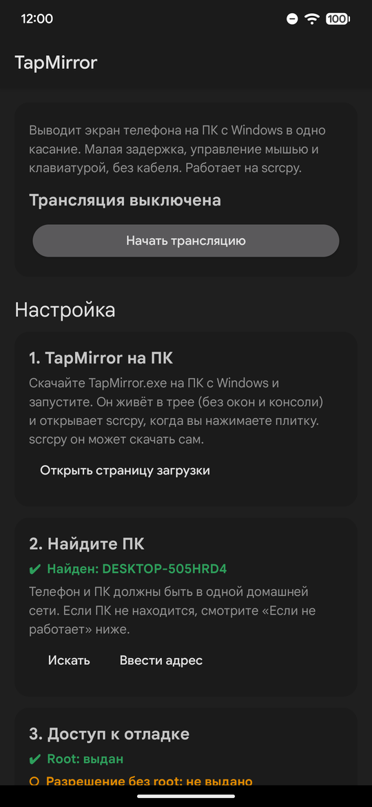
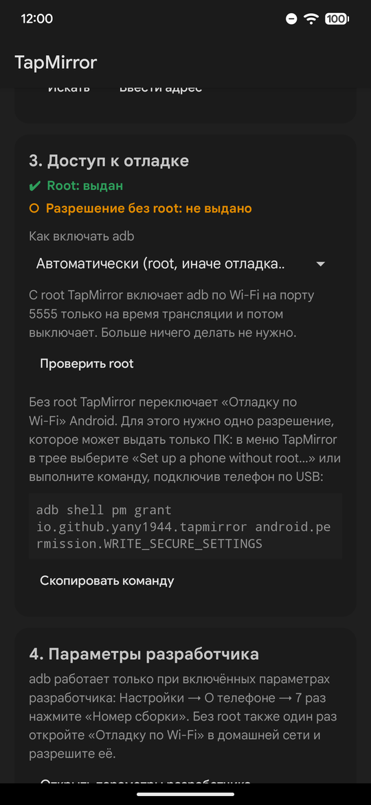
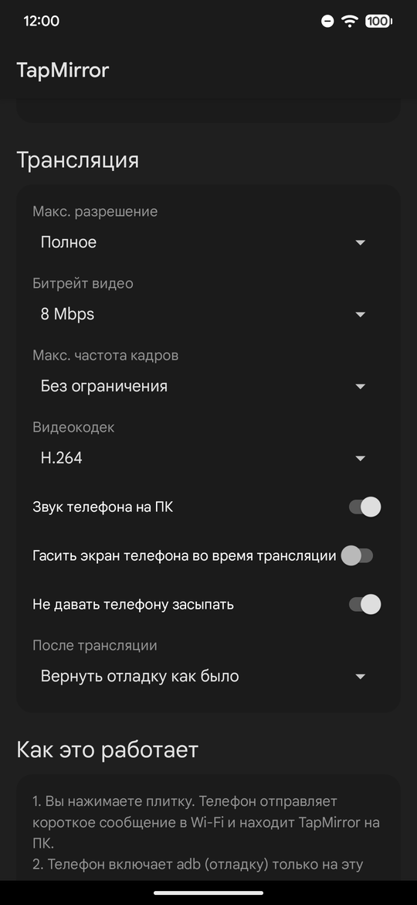

<p align="center">
  
</p>

<h1 align="center">TapMirror</h1>

<p align="center">
  Нажмите плитку в шторке Android, и экран телефона откроется на компьютере с Windows.<br>
  По Wi-Fi, с управлением мышью и клавиатурой. Работает на <a href="https://github.com/Genymobile/scrcpy">scrcpy</a>.
</p>

<p align="center">
  <a href="https://github.com/Yany1944/TapMirror/releases/latest"></a>
  <a href="https://github.com/Yany1944/TapMirror/actions/workflows/build.yml"></a>
  
  
  <a href="LICENSE"></a>
</p>

<p align="center"><a href="README.md">English</a> · <b>Русский</b></p>

> [!NOTE]
> Это ранняя версия (0.1.0). Пока её проверяли на одном телефоне и одном компьютере, они перечислены в разделе [На чём проверено](#на-чём-проверено). Ошибки вполне возможны, особенно на других телефонах. Если что-то не работает, [создайте issue](https://github.com/Yany1944/TapMirror/issues/new/choose): приложение само скопирует всё, что нужно для отчёта.

<p align="center">
  
  &nbsp;
  
  &nbsp;
  
</p>

## Что это

scrcpy и так показывает экран Android на компьютере почти без задержки и даёт управлять им мышью и клавиатурой. Но чтобы пользоваться им по Wi-Fi, обычно нужно подключить кабель, выполнить `adb tcpip`, ввести адрес телефона в консоли и не забыть потом выключить отладку. TapMirror делает всё это сам:

- Плитка «Экран на ПК» в шторке запускает трансляцию. Нажмите её ещё раз, чтобы остановить, или просто закройте окно.
- Маленькая программа в трее на ПК ждёт телефон и открывает scrcpy без окна консоли. В ожидании она не тратит процессор и занимает около 25 МБ памяти.
- Отладка включена только во время трансляции. Телефон включает adb, когда вы нажимаете плитку, и возвращает всё как было, когда сеанс заканчивается. Банковские и государственные приложения, которые не запускаются при включённой отладке по USB, в остальное время работают как обычно.
- Работает с root и без него. Root проверен с Magisk; у KernelSU и APatch такой же `su`, так что с ними тоже должно работать. Без root нужно один раз выдать разрешение с компьютера.
- Приложение на телефоне одновременно и инструкция: список шагов настройки с кнопкой для каждого, а ещё разрешение, битрейт, частота кадров, кодек, звук и другие настройки scrcpy.
- Когда новый телефон впервые просит трансляцию, компьютер показывает окно: разрешить его или заблокировать.
- Английский и русский языки.

## Как это работает

```
 Телефон                                             ПК (программа в трее)
 ───────                                             ─────────────────────
 Вы нажимаете плитку
 «Есть тут TapMirror?»       ── UDP 27199 ──────▶    «Да, я DESKTOP-ABC»
 Включает adb на этот сеанс:
   с root:   adb по TCP, порт 5555
   без root: отладка по Wi-Fi
 «Начни трансляцию»          ─────────────────▶     В первый раз: «Разрешить телефон?»
                                                     adb connect, затем scrcpy
                             ◀─────────────────     «Окно открыто»
 «Ты тут?» каждые 3 с        ─────────────────▶     «Да»
                             ◀─────────────────     «Окно закрыли»
 Выключает adb обратно
```

Если окно закрыли, плитку нажали ещё раз, компьютер уснул или телефон ушёл из Wi-Fi, телефон выключает отладку примерно через 12 секунд. Формат сообщений описан в [docs/protocol.md](docs/protocol.md) (на английском).

## Что нужно

- Телефон на Android 11 или новее.
- Компьютер с Windows 10 или 11 (64 бита). Используется встроенный в Windows .NET Framework 4.8, ставить ничего не нужно.
- Оба устройства в одной домашней сети и видят друг друга. Гостевые сети и роутеры с включённой «изоляцией клиентов» (AP isolation) этому мешают.
- Root или один раз компьютер с adb, чтобы выдать разрешение без root. Программа в трее сделает это сама по кабелю или по коду сопряжения.

## Быстрая настройка с ИИ-помощником

Если на компьютере есть ИИ-помощник, он может пройти настройку вместе с вами: проверит, подходят ли телефон и компьютер, установит оба приложения и подскажет, что включить на вашем телефоне, с root или без. Скопируйте ему это сообщение:

```text
Помоги мне настроить TapMirror (трансляция экрана Android на Windows). Прочитай https://raw.githubusercontent.com/Yany1944/TapMirror/main/docs/ai-setup.md и выполняй шаг за шагом. Объясняй, что делаешь, и спрашивай меня перед тем, как что-то устанавливать или менять. Отвечай по-русски.
```

Помощники, которые умеют выполнять команды на компьютере (Claude Code, Codex CLI, Cursor, Gemini CLI), проверят всё сами. Чат в браузере (ChatGPT, Claude, Gemini) будет давать команды для PowerShell и читать то, что вы вставите в ответ. Держите рядом телефон и USB-кабель.

Помощник работает по инструкции [docs/ai-setup.md](docs/ai-setup.md) (на английском), её можно прочитать заранее. В ней перечислено всё, что он проверяет и меняет, и как это отменить, а скачивает он только с GitHub (TapMirror, scrcpy) и Google (adb). И всё же читайте каждую команду, прежде чем разрешить её.

Если хотите сделать всё сами, шаги ниже.

## Установка

### 1. На компьютере

1. Скачайте [TapMirror.exe](https://github.com/Yany1944/TapMirror/releases/latest/download/TapMirror.exe), положите в отдельную папку (например, `Документы\TapMirror`) и запустите.
2. Windows может показать «Система Windows защитила ваш компьютер», потому что файл не подписан. Нажмите «Подробнее», затем «Выполнить в любом случае».
3. При первом запуске TapMirror предложит:
   - скачать свежий официальный scrcpy с GitHub (контрольная сумма SHA-256 проверяется);
   - добавить правило брандмауэра Windows для UDP-порта 27199 (попросит права администратора).

   Согласитесь на оба. Дальше TapMirror живёт в трее и запускается вместе с Windows.

### 2. На телефоне

1. Скачайте [TapMirror.apk](https://github.com/Yany1944/TapMirror/releases/latest/download/TapMirror.apk) и установите. Android попросит разрешить установку из браузера, Play Защита может предложить проверить приложение.
2. Откройте TapMirror. На первом экране список шагов, пройдите его сверху вниз:
   1. TapMirror на компьютере.
   2. Найдите ПК (кнопка «Искать»).
   3. Доступ к отладке. С root нажмите «Проверить root» и разрешите в менеджере root. Без root смотрите ниже.
   4. Параметры разработчика. Включите их, если ещё не включены: Настройки → О телефоне → 7 раз нажмите «Номер сборки».
   5. Добавьте плитку в шторку.
   6. Уведомления: включите их или, если нужна только плитка, оставьте выключенными.
3. Нажмите плитку. В первый раз компьютер спросит, разрешить ли этот телефон, а телефон может спросить «Разрешить отладку по USB?» для этого компьютера. Отметьте «Всегда разрешать».

### Без root

Без root приложение само включает и выключает «Отладку по Wi-Fi». Для этого ему нужно разрешение `WRITE_SECURE_SETTINGS`, которое может выдать только компьютер. В меню TapMirror в трее выберите «Set up a phone without root…» и один из двух способов:

- С кабелем: включите отладку по USB, подключите телефон, нажмите «Разрешить» на телефоне, затем «Grant over USB».
- Без кабеля: на телефоне откройте «Для разработчиков» → «Отладка по Wi-Fi» → «Подключить устройство с помощью кода», введите адрес и код в окне на компьютере и нажмите «Pair and grant».

Если вы уже пользуетесь adb, то же самое делает команда:

```
adb shell pm grant io.github.yany1944.tapmirror android.permission.WRITE_SECURE_SETTINGS
```

Потом в каждой сети Wi-Fi, где будете пользоваться TapMirror, один раз откройте «Отладку по Wi-Fi» и разрешите её («Всегда разрешать в этой сети»).

|  | С root | Без root |
|---|---|---|
| Как включается adb | через `su`: adb по TCP на порту 5555 | «Отладка по Wi-Fi» через `WRITE_SECURE_SETTINGS` |
| Настройка один раз | разрешить root для приложения | выдать разрешение с компьютера |
| В новой сети Wi-Fi | ничего | один раз разрешить там отладку по Wi-Fi |
| Как ПК находит adb | постоянный порт | mDNS |
| После трансляции | отладка возвращается как была | отладка по Wi-Fi выключается |

## Настройки

На телефоне, в разделе «Трансляция»:

| Настройка | По умолчанию | Что меняет в scrcpy |
|---|---|---|
| Макс. разрешение | Полное | `--max-size` |
| Битрейт видео | 8 Мбит/с | `--video-bit-rate` |
| Макс. частота кадров | Без ограничения | `--max-fps` |
| Видеокодек | H.264 | `--video-codec` |
| Звук телефона на ПК | Вкл. | `--no-audio`, если выключено |
| Гасить экран телефона во время трансляции | Выкл. | `--turn-screen-off` |
| Не давать телефону засыпать | Вкл. | `--stay-awake` |
| После трансляции | Вернуть отладку как было | или всегда выключать |

Уведомления (шаг 6): если они включены, во время трансляции видно уведомление со статусом и кнопкой «Стоп». Android не даёт приложению скрыть это уведомление самому, поэтому для режима «только плитка» уведомления TapMirror выключаются в настройках системы. Кнопка в шаге 6 открывает нужную страницу.

На компьютере файл `%APPDATA%\TapMirror\TapMirror.ini` хранит папку scrcpy, путь к adb (необязательно), дополнительные опции scrcpy для каждого сеанса (например, `args=--window-borderless`) и списки разрешённых и заблокированных телефонов. Обычно хватает меню в трее. Журнал лежит в `%LOCALAPPDATA%\TapMirror\TapMirror.log` (меню в трее → «Open log»).

## На чём проверено

| | |
|---|---|
| Телефон | Google Pixel 7 Pro, Android 17 QPR3 Beta 2 |
| Root | Magisk Alpha. Режим без root проверен на том же телефоне, режим root был выключен в приложении |
| Компьютер | Windows 11 Pro 26H2 (сборка 26300), подключён кабелем; телефон в Wi-Fi 5 ГГц |
| scrcpy и adb | scrcpy 4.1, adb 37.0.1 |
| VPN | на телефоне VPN-приложение, которое другие приложения не могут обойти |

Что работает: запуск и остановка плиткой, закрытие окна, несколько быстрых нажатий подряд, разрешение нового телефона на компьютере, режимы с root и без, возврат отладки после сеанса, отключение через 12 секунд без связи и трансляция с включённым VPN.

Пока не проверено: другие телефоны и Android с 11 по 16, KernelSU и APatch, Windows 10, компьютер с включённым брандмауэром Windows, скачивание scrcpy, сопряжение по коду, несколько компьютеров или телефонов одновременно. Если попробуете что-то из этого, короткое «работает» или «не работает» в issue очень поможет.

## Известные проблемы и ограничения

- VPN на телефоне. VPN, который приложения не могут обойти, пропускает телефон к компьютеру только по уже известному адресу, поэтому первый поиск может ничего не найти. Один раз найдите ПК с выключенным VPN или нажмите «Ввести адрес» в шаге 2 и введите адрес из меню в трее («This PC: …»). После этого всё работает и с VPN.
- Без root. Android не даёт обычным приложениям читать настройки отладки, поэтому без root TapMirror не знает, была ли «Отладка по Wi-Fi» включена раньше, и после сеанса всегда её выключает. По той же причине приложение не может показать, включены ли параметры разработчика.
- Только плитка. Без уведомлений ошибки видны только на плитке («Ошибка, откройте приложение») и в приложении.
- Только Windows. Программы для macOS и Linux пока нет, а сама программа для ПК на английском.
- AV1. У большинства телефонов нет кодера AV1; если с ним не работает, выберите H.264 или H.265.
- Безопасность. Сообщения между телефоном и компьютером не шифруются и не подписываются, поэтому пользуйтесь TapMirror в сетях, которым доверяете, например дома. Пока идёт сеанс, adb на телефоне доступен из сети, но принимает только разрешённые вами компьютеры. Подробности в [docs/protocol.md](docs/protocol.md#security-notes).

## Если не работает

| Проблема | Что сделать |
|---|---|
| «ПК не ответил» | Проверьте, что TapMirror есть в трее и оба устройства в одной сети. Если в меню в трее есть «Allow through Windows Firewall», нажмите его. Гостевые сети и изоляция клиентов не дают устройствам видеть друг друга. |
| «ПК не ответил» при включённом VPN | Нажмите «Ввести адрес» в шаге 2 (см. «VPN на телефоне» выше). |
| Окно не открывается, ошибка adb | Телефон может спрашивать «Разрешить отладку по USB?» для этого компьютера. Разблокируйте его и отметьте «Всегда разрешать». |
| Без root: «Wireless debugging didn't start on the phone» | Один раз откройте «Для разработчиков» → «Отладка по Wi-Fi» в этой сети и разрешите. |
| Банковское приложение ругается на отладку | В «После трансляции» выберите «Всегда выключать отладку». |
| Задержка или плохая картинка | Уменьшите разрешение или битрейт, подключитесь к Wi-Fi 5 ГГц, по возможности подключите компьютер кабелем. |
| «Port 27199 is already in use» на компьютере | Запущена вторая копия TapMirror. Закройте её через трей или в диспетчере задач. |

## Как сообщить об ошибке

Заполните [форму отчёта об ошибке](https://github.com/Yany1944/TapMirror/issues/new?template=bug_report.yml). Перед этим скопируйте сведения для отчёта:

- на телефоне: TapMirror → «Если не работает» → «Скопировать сведения для отчёта»;
- на компьютере: меню в трее → «Copy info for a bug report».

Вставьте оба текста в форму. В них версии, ваши настройки (режим, root, VPN, брандмауэр) и недавний журнал, данных других приложений там нет. Писать в issue можно и по-русски. Идеи оформляйте как [предложение](https://github.com/Yany1944/TapMirror/issues/new?template=feature_request.yml). О проблемах безопасности не пишите в открытых issue; как сообщить о них, написано в [SECURITY.md](SECURITY.md).

## Сборка из исходников

- Программа для ПК: запустите `windows\build.cmd`. Он использует компилятор C#, встроенный в Windows, SDK не нужен. Результат: `windows\bin\TapMirror.exe`.
- Приложение для телефона: нужны JDK 17 или новее и Android SDK с platform 35. В папке `android` выполните `gradlew assembleDebug`. Подписанный выпуск описан в [docs/RELEASING.md](docs/RELEASING.md).
- `build.cmd` в корне собирает оба в `dist\`.

```
android/   приложение для телефона (Java, без библиотек): плитка, сеанс, список настройки, настройки
windows/   программа в трее (C#, .NET Framework 4.8): приём UDP, запуск scrcpy, окно настройки без root
docs/      протокол, инструкция для ИИ-помощников, порядок выпуска, скриншоты
```

Помощь в разработке приветствуется, подробности в [CONTRIBUTING.md](CONTRIBUTING.md).

## Благодарности

Саму трансляцию делает [scrcpy](https://github.com/Genymobile/scrcpy) от Genymobile и Romain Vimont (Apache License 2.0). TapMirror только запускает его в нужный момент и не связан с Genymobile.

## Лицензия

[MIT](LICENSE)
